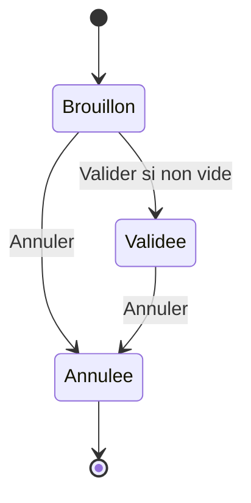
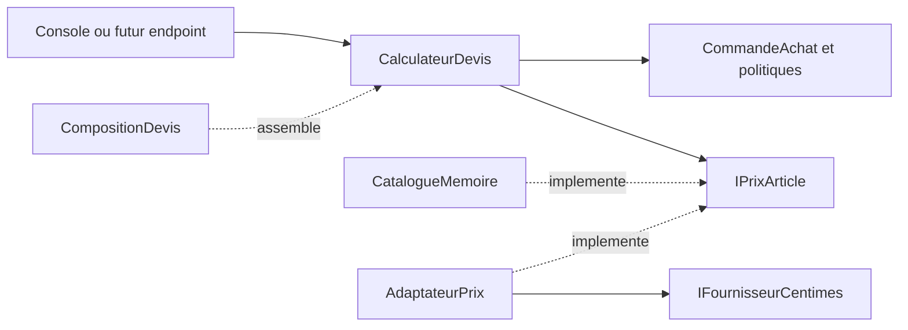

# C# avance : comprendre, mesurer, concevoir

Pour un apprentissage pas a pas, suivre les [16 tutoriels guides](Tutoriels/README.md).
Ce document reste le memo transversal et le complement d'etudes de cas.

## Organisation

Objectif : savoir expliquer le comportement du runtime et defendre une conception,
pas apprendre une liste de mots-clefs. Les lecons 1 a 8 sont des rappels a consulter au besoin.

Pour chaque chapitre : predire, implementer, tester, puis expliquer le compromis.
Les contrats precis sont dans les fichiers de [Lecons](Lecons), les implementations dans [Solutions](Solutions).

Depuis le dossier du bootcamp :

```bash
dotnet run -- 10
dotnet run -p:Corriges=true -- 10
```

Le code de sortie 1 en mode exercice est normal tant que des methodes restent a faire.
Les 37 nouveaux tests verifient les contrats observables ; ils ne prouvent pas l'absence
d'allocations, une performance, ni la pertinence d'une architecture.
Les exemples supplementaires de ce guide sont a analyser ; ils ne sont pas tous des tests executes.

## 09 - Memoire : emplacement, identite et copies

Rappel minimal : une variable de type reference contient une reference vers un objet ;
une variable de type valeur contient une valeur. Passer un objet a une methode copie
normalement sa reference, pas l'objet. `ref` permet de modifier la variable de l'appelant.

### Exemple 1 : copier une reference

```csharp
var original = new List<int> { 1, 2 };
var alias = original;
alias.Add(3);
Console.WriteLine(original.Count); // 3 : une seule liste
alias = new List<int>();
Console.WriteLine(original.Count); // toujours 3 : reaffecter l'alias ne change pas original
```

### Exemple 2 : un struct contenant une reference

```csharp
public struct Panier
{
    public int Version;
    public List<string> Articles;
}

var premier = new Panier { Version = 1, Articles = new() { "A" } };
var second = premier;
second.Version = 2;
second.Articles.Add("B");
Console.WriteLine(premier.Version);        // 1 : champ valeur copie
Console.WriteLine(premier.Articles.Count); // 2 : reference copiee, liste partagee
```

Un `readonly struct` interdit certaines mutations de ses champs, pas les mutations des objets
references par ces champs. De meme, `IReadOnlyList<T>` ne garantit pas a lui seul l'immuabilite
de l'objet sous-jacent, ni celle des elements.

### Exemple 3 : record et fausse copie profonde

```csharp
var profil = new ProfilMemoire("Sara", new() { "Lecture" });
var autre = profil with { Nom = "Lea" };
Console.WriteLine(ReferenceEquals(profil, autre));             // false
Console.WriteLine(ReferenceEquals(profil.Roles, autre.Roles)); // true
```

`record` apporte notamment une egalite par membres. Il ne rend pas les objets references
immuables et ne compare pas automatiquement deux listes element par element.
Une copie de `List<string>` suffit ici car les chaines sont immuables ; avec des elements
mutables, il faut definir leur politique de copie aussi.

### Stack, heap, GC : le modele utile

- Un champ `int` d'une classe fait partie de cet objet ; il n'est pas automatiquement sur la stack.
- Un tableau de structs contient les valeurs dans le tableau ; un tableau de classes contient des references.
- Une variable locale peut vivre dans un registre. Une capture ou une machine d'etat async peut prolonger sa vie.
- Le GC suit l'accessibilite depuis des racines : statiques, piles des threads, handles, etc.
- Un objet peut etre inutilisable fonctionnellement mais encore accessible : cache sans eviction, evenement non desabonne.
- Les generations 0/1/2 favorisent les objets a courte duree de vie. Les gros objets vont generalement
  sur le LOH, autour de 85 000 octets, taille totale de l'objet comprise. Ce seuil est configurable.
- `GC.Collect()` dans une requete n'est pas une strategie de gestion memoire.

**Exercices executes** : copie de struct, mutation par `ref`, copie superficielle par `with`, instantane independant.

**Approfondissement** : dessiner les objets et les fleches de l'exemple `Panier`. Expliquer pourquoi
un service singleton qui conserve un objet de requete peut causer une retention memoire.
Pour un abonnement a un evenement de longue duree de vie, identifier qui doit se desabonner et quand.

## 10 - Boxing, unboxing et generiques

### Exemple 4 : une boite contient une copie

```csharp
int nombre = 42;
object boite = nombre;
nombre = 99;
Console.WriteLine((int)boite); // 42
// long erreur = (long)boite;  // InvalidCastException : la boite contient un int, pas un long
long correct = (long)(int)boite;
```

Le boxing d'un type valeur non nullable cree semantiquement un objet contenant une copie.
Certaines allocations peuvent etre eliminees par le JIT : ne pas confondre le modele du langage
et un nombre d'octets garanti dans toutes les versions du runtime.

### Exemple 5 : nullable n'est pas une boite de Nullable

```csharp
int? absent = null;
int? present = 7;
object? premier = absent;  // null
object? second = present; // int boxe
Console.WriteLine(second!.GetType() == typeof(int)); // true
```

### Exemple 6 : conversion vers une interface

```csharp
IdentifiantClient id = new(5);
IEquatable<IdentifiantClient> interfaceBoxee = id;
bool egal = interfaceBoxee.Equals(new IdentifiantClient(5));

static bool Comparer<T>(T gauche, T droite) where T : struct, IEquatable<T>
    => gauche.Equals(droite);
```

La conversion du struct vers l'interface est un boxing. L'appel generique contraint evite
cette conversion dans le corps ; le runtime peut appeler directement l'implementation du struct.
Cela ne garantit pas que toute methode `Equals` imaginable soit sans allocation interne.

`List<int>` evite de boxer chaque element contrairement a `ArrayList`. Une enumeration de
`List<int>` via `IEnumerable<int>` peut toutefois boxer son enumerateur struct :
**pas de boxing par element** ne signifie pas **zero allocation totale**.
La variance `IEnumerable<Derived>` vers `IEnumerable<Base>` concerne les types reference,
pas une conversion elementaire automatique de `IEnumerable<int>` en `IEnumerable<object>`.

**Exercices executes** : unboxing strict, comportement de nullable, egalite generique, somme sans debordement d'int.

**Laboratoire de mesure** : comparer une boucle remplissant un `int[]` prealloue et une boucle
remplissant un `object[]` prealloue avec les memes entiers. Garder les tableaux observables apres
la mesure pour eviter une elimination de travail. Mesurer l'ecart avec `GC.GetAllocatedBytesForCurrentThread()`
sur le meme thread, apres echauffement, en Release, sans journalisation dans la zone mesuree.
Ne pas imposer un nombre exact d'octets dans un test portable.
Pour des conclusions serieuses, utiliser un projet de benchmark separe avec BenchmarkDotNet et MemoryDiagnoser.

## 11 - Reduire les allocations sans perdre la securite

### Exemple 7 : une vue n'est pas une nouvelle chaine

```csharp
string message = "code=12345";
ReadOnlySpan<char> chiffres = message.AsSpan(5);
int valeur = int.Parse(chiffres);
```

`Substring` produit une nouvelle chaine ; `AsSpan` cree une vue sur les caracteres existants.
Une petite vue peut prolonger la vie de son support pendant son utilisation.
`Span<T>` est un `ref struct` : en C# 12/.NET 8, pas de champ dans une classe,
pas de capture par lambda, pas de locale Span dans une methode async.
Utiliser `Memory<T>` pour representer un segment qui doit traverser une attente async,
avec une politique explicite de propriete du buffer.

### Exemple 8 : location et duree de vie

```csharp
var pool = System.Buffers.ArrayPool<byte>.Shared;
byte[] buffer = pool.Rent(4096);
try
{
    buffer.AsSpan(0, 4096).Clear();
    // Lire/ecrire uniquement la portion utile, pas buffer.Length par habitude.
}
finally
{
    pool.Return(buffer, clearArray: true);
}
```

Un buffer loue peut contenir des donnees precedentes et etre plus grand que demande.
Ne pas le retourner deux fois, l'utiliser apres Return, ou le rendre pendant qu'une I/O l'utilise.
Le nettoyage demande au pool limite la relecture accidentelle par un prochain locataire ;
ce n'est pas une garantie universelle d'effacement cryptographique de toutes les copies d'un secret.
Le pooling peut accroitre la memoire retenue : mesurer avant d'en ajouter partout.

### Exemple 9 : qui ferme la ressource ?

`LireSansFermer` recoit un flux emprunte. Le lecteur lui appartient, pas le flux :
`using` sur le lecteur avec `leaveOpen: true`, fermeture du flux par l'appelant.
Pour une ressource `IAsyncDisposable`, utiliser `await using` lorsque la liberation est asynchrone.
Ne pas ajouter de finalizer a chaque classe : les ressources natives passent souvent par `SafeHandle`.

**Exercices executes** : traitement d'une slice, buffer utile, restitution sur erreur,
rejet d'une taille invalide avant location, flux encore ouvert apres lecture.

**Approfondissement** : comparer une copie defensive, un tableau partage et un buffer loue.
Pour chaque variante, nommer le proprietaire, la duree de validite et le risque d'alias.

## 12 - Async, annulation et concurrence

### Exemple 10 : distinguer attente et travail CPU

```csharp
static async Task<string> LireAsync(HttpClient client, Uri uri, CancellationToken token)
{
    using var reponse = await client.GetAsync(uri, token);
    reponse.EnsureSuccessStatusCode();
    return await reponse.Content.ReadAsStringAsync(token);
}
```

Le `HttpClient` est fourni par l'appelant et reutilise, pas cree pour chaque requete.
`Task.Run(() => client.GetAsync(...))` n'ameliore pas une I/O deja asynchrone.
Sur un serveur, `Task.Run` n'ajoute pas de capacite CPU ; il deplace du travail sur le pool.
`ConfigureAwait(false)` n'est ni un remede aux races ni un accelerateur general.
`ValueTask<T>` peut economiser certaines allocations, mais ajoute des contraintes de consommation :
preferer `Task<T>` sans mesure justifiant sa complexite, et ne pas reconsommer arbitrairement une ValueTask.

### Exemple 11 : trois limites differentes

- `Task.WhenAll` attend un groupe ; il ne limite pas le nombre d'operations lancees.
- `Parallel.ForEachAsync` borne les operations actives. Pour un flux producteur/consommateur,
  un `Channel<T>` borne peut aussi fournir de la backpressure sur les elements en attente.
- Un rate limiter borne une frequence (appels/seconde), pas simplement une concurrence.

Le token de la boucle peut combiner le token appelant et une annulation interne.
Verifier son effet plutot que son egalite exacte au token initial.
`Interlocked` convient a un increment, pas a un invariant complexe portant sur plusieurs champs.
Pour un etat compose, envisager un verrou court ou un seul proprietaire via passage de messages.

**Exercices executes** : vraie borne d'activite, ordre des resultats malgre des fins inversees,
batch vide, annulation en cours, erreur propagee, increment atomique.
Les tests utilisent des signaux plutot que des delais arbitraires ; les 5 secondes ne sont
qu'un garde-fou contre un blocage, pas une assertion de performance.
Le moteur est synchrone : `GetAwaiter().GetResult()` est limite a cette frontiere de test console.

**Approfondissement** : concevoir l'arret d'un worker utilisant un Channel borne :
qui complete le writer, qui observe les erreurs, et les elements restants sont-ils draines ou abandonnes ?

## 13 - Strategy, Decorator et injection

Probleme concret : calculer un total avec plusieurs politiques commerciales, puis journaliser
sans melanger les prix, le choix de remise et l'affichage.

```csharp
IPolitiqueRemise politique = new RemiseFidelite(0.10m);
IPolitiqueRemise auditee = new RemiseJournalisee(politique, Console.WriteLine);
var service = new ServiceTarification(auditee);
decimal net = service.Total(new[] { 80m, 20m }); // 90 ; journal : total=90.00
```

**Strategy** isole une famille d'algorithmes interchangeables.
Pour deux formules stables et locales, un simple switch peut etre plus lisible qu'une hierarchie.
Une fonction `Func<decimal, decimal>` peut aussi suffire quand le contrat ne demande pas un objet nomme.

**Decorator** ajoute un comportement tout en preservant le contrat.
L'ordre des decorateurs compte : journaliser avant ou apres un cache ne compte pas les memes appels.
Le journal de cette lecon peut lever une exception : le choix est explicite et teste,
mais dans un produit, decider si un echec de telemetrie doit vraiment faire echouer le metier.

L'injection de dependances ne necessite pas de conteneur. Un constructeur suffit ici.
Un service locator masque les dependances. Un conteneur DI ne corrige pas des responsabilites mal separees.
Avec un conteneur, ne pas capturer un service scoped dans un singleton ; verifier les durees de vie.

**Exercices executes** : remplacement d'une politique, arrondi, validation, delegation unique,
culture du journal, absence de faux message de succes.

**Approfondissement** : proposer une remise plafonnee. Est-ce une nouvelle Strategy ou un Decorator ?
Donner les deux compositions et montrer sur 100 euros pourquoi l'ordre peut changer le resultat.

## 14 - Adapter et construction des objets

L'application exprime ses prix en euros. Le fournisseur historique expose des centimes.
L'adaptateur traduit les unites et les absences, mais ne deguise pas une panne reseau en prix zero.

```csharp
IPrixArticle catalogue = new AdaptateurPrix(fournisseurExterne);
IExporteur exporteur = FabriqueExport.Creer("json");
string contenu = exporteur.Exporter(new[] { new LigneExport("A<&", 12.99m) });
```

Ce fragment suppose un `IFournisseurCentimes` fourni par la composition.
La lecon utilise les bibliotheques JSON/XML standard pour l'echappement et la structure.
La factory est une **simple factory**, pas le GoF Factory Method (redefinition de creation par heritage)
ni une Abstract Factory (familles coherentes d'objets).
Pour deux formats fixes, ce switch est volontairement raisonnable ; ne pas ajouter un systeme de plugins sans besoin.

**Exercices executes** : fractions de prix conservees, absence distincte de zero,
donnee invalide, panne propagee, export avec caracteres speciaux et collections vides.

**Approfondissement** : definir un contrat de devise explicite avant d'integrer un second fournisseur.
Un `decimal` seul ne dit pas EUR ou USD ; un adaptateur ne doit pas inventer un taux de change.

## 15 - Un domaine qui protege ses invariants

Un DTO transporte des donnees. Un agregat protege des regles qui doivent rester coherentes ensemble.
`CommandeAchat` choisit des operations metier plutot que des setters publics.

```csharp
var commande = new CommandeAchat();
commande.Ajouter("A", 2, 12.50m);
commande.Valider();
// commande.Ajouter("B", 1, 5m); // interdit : la commande est figee
commande.Annuler();
```



Les lignes sont des records immuables et la collection exposee est un instantane.
Ce choix alloue a chaque lecture ; une collection immuable maintenue par l'agregat peut etre
une alternative si le profil d'utilisation le justifie. Exposer directement une List castee en
IReadOnlyList ne suffit pas a empecher un cast retour ou des mutations par un autre alias.

Une transition locale n'est pas une transaction distribuee. Cette commande ne reserve pas du stock
et son etat n'est pas protege contre deux processus concurrents.
En base, une version de concurrence optimiste permet de detecter deux mises a jour incompatibles.

**Exercices executes** : invariants d'entree, absence de mutation partielle sur entree invalide,
instantane sans alias, validation et annulation terminale.

**Approfondissement** : dessiner les transitions Payee, Expediee, Remboursee.
Une enum et des gardes restent preferables tant que le comportement est simple ; envisager State
si les comportements par etat et transitions deviennent suffisamment riches pour le justifier.

## 16 - Architecture : separer les decisions des details

Le fil rouge calcule un devis. Il ne simule pas un paiement ou une transaction qu'il ne sait pas garantir.



Les fleches representent les dependances de code ; a l'execution, le cas d'usage appelle
l'adaptateur a travers le port. L'interface est definie par le besoin applicatif, pas par les tables d'une base.
Le domaine ne choisit ni fournisseur, ni connexion, ni UI.

Le bootcamp conserve un seul projet pour rester facile a executer. C'est une demonstration des
responsabilites, **pas une separation d'assemblies imposee par le compilateur**.
Dans un produit : Domaine sans infrastructure, Application vers Domaine, Infrastructure vers les contrats,
et point d'entree qui assemble le tout. Ajouter des projets seulement quand leur frontiere est utile.

```csharp
var service = CompositionDevis.Creer();
ResultatDevis resultat = service.Calculer(new[] { new DemandeDevis("CLAVIER", 1) });
string message = resultat switch
{
    ResultatDevis.Accepte accepte => $"Net : {accepte.Net:0.00}",
    ResultatDevis.Refuse refuse => $"Refus : {refuse.Motif}",
    _ => throw new InvalidOperationException("Resultat inconnu")
};
```

Un refus metier est un resultat attendu ; une panne de stockage n'est pas un article inconnu.
La politique de retry appartient a une frontiere technique bien choisie et exige l'idempotence
si l'operation produit des effets. Ne pas retenter aveuglement un paiement.

**Exercices executes** : composition reelle, meme cas d'usage avec deux adaptateurs,
validation avant I/O, absence distincte de gratuite, pannes non masquees.

## Choisir une architecture : quatre etudes de cas

Ces choix ne sont pas quatre niveaux d'une echelle de maturite. Certains sont combinables :
un monolithe modulaire peut utiliser ports/adaptateurs dans ses modules.
Commencer par les contraintes, pas par un nom d'architecture.

### Cas A - Outil interne CRUD, trois developpeurs

Contraintes : 200 utilisateurs, regles simples, une base relationnelle, deploiement hebdomadaire.
**Choix initial : monolithe simple en couches**, presentation/application/acces aux donnees.
Avantages : deploiement et transactions simples, faible cout d'exploitation.
Ne pas ajouter des interfaces et repositories generiques uniquement pour envelopper chaque appel ORM.
Revoir ce choix si les regles metier ou les frontieres d'equipe deviennent reellement complexes.

### Cas B - Commerce avec promotions, stock et plusieurs fournisseurs

Contraintes : regles riches, fournisseurs remplaces regulierement, une equipe de huit personnes.
**Choix initial : monolithe modulaire, ports/adaptateurs aux frontieres variables**.
Modules commandes, catalogue et facturation avec proprietaires de donnees identifies.
Tests unitaires du domaine, tests de contrat des adaptateurs, tests d'integration de la persistance.
Un faux en memoire ne prouve ni la semantique SQL ni les contraintes d'une API distante.
Pas de microservices tant que leur autonomie ne compense pas le cout du reseau et de l'exploitation.

### Cas C - Notifications massives, equipes et charges independantes

Contraintes : pics de plusieurs ordres de grandeur, reprise apres panne, envoi au moins une fois,
equipes autonomes, observabilite et exploitation deja disponibles.
**Choix plausible : workers separes avec broker**, et eventuellement services par capacite metier.
Prevoir backpressure, retry borne, dead-letter, deduplication et idempotence.
Si une modification SQL doit publier un evenement, l'outbox rapproche l'ecriture metier et le message
dans la meme transaction locale ; le relais peut republier, donc le consommateur reste idempotent.
Ne pas promettre un effet externe exactement une fois sans protocole le garantissant.

### Cas D - Tableau de bord avec lectures complexes et nombreuses

Contraintes : lectures tres majoritaires, ecritures simples, retard de 30 secondes acceptable.
**Choix initial : modele de lecture optimise**, eventuellement CQRS leger dans le meme deploiement.
Commencer par index, projection et mesure avant de distribuer le systeme.
CQRS separe commandes et lectures ; il n'impose ni microservices ni event sourcing.
Event sourcing change la source de verite et exige evolution des evenements, reconstruction et exploitation :
ne pas l'ajouter uniquement pour obtenir un historique d'audit.

### Grille de decision

| Question | Effet sur le choix |
|---|---|
| Quelles regles doivent etre atomiques ? | Favoriser une frontiere transactionnelle locale claire |
| Qu'est-ce qui varie vraiment ? | Placer un port autour de ce detail, pas autour de tout |
| Quel volume et quelle latence mesures ? | Optimiser le point limitant avant de distribuer |
| Quelle coherence est exigee ? | Ne pas accepter une projection en retard pour une garantie immediate |
| Combien d'equipes et quelle autonomie ? | Une frontiere de service doit avoir un proprietaire et une raison |
| Qui exploite les pannes a 3 h du matin ? | Le cout du distribue fait partie du design |
| Comment tester et migrer ? | Verifier les contrats et evoluer progressivement |

## Projet final - Defendre une solution

Sujet : devis puis reservation de stock pour un commerce multifornisseur.
Rester dans le bootcamp pour le devis ; la reservation ci-dessous est un travail de conception,
pas une fonctionnalite deja implementee par les corriges.

1. Ecrire une ADR d'une page avec contexte, contraintes, options, decision, consequences et criteres de reevaluation.
2. Comparer au moins deux options : monolithe en couches et monolithe modulaire avec ports/adaptateurs.
3. Dessiner les dependances de code ET le flux d'execution, qui ne sont pas la meme chose.
4. Definir l'atomicite voulue si deux clients reservent le dernier article ; choisir transaction/verrou/version selon le stockage.
5. Traiter le timeout fournisseur : resultat inconnu, echec certain ou succes certain ? Definir l'idempotence et la reprise.
6. Ajouter un adaptateur, puis des tests de contrat communs et des tests d'integration propres a sa technologie.
7. Mesurer une allocation et une latence avant/apres une optimisation. Expliquer ce qu'elle coute en complexite.

### Exemple d'ADR courte

**Contexte** : une equipe, deux fournisseurs, transactions locales suffisantes pour la commande,
deploiement quotidien, pas d'equipe d'exploitation de broker.

**Options** : monolithe en couches ; monolithe modulaire ; services independants par domaine.

**Decision** : monolithe modulaire. Ports pour les fournisseurs externes, domaine sans dependance HTTP.
Une seule application deployee ; transactions de stock locales si le stock est sous notre controle.

**Consequences** : exploitation simple et regles testables ; discipline necessaire pour eviter les acces directs
aux donnees d'un autre module. Pas de deploiement independant des modules.
Pour un stock externe, aucune transaction SQL locale ne garantit sa reservation : il faut un protocole metier
de confirmation/compensation explicite.

**Reevaluation** : extraction envisagee seulement si une capacite exige une charge, un rythme de livraison
ou une isolation de panne independants, et si l'equipe peut assumer les nouveaux modes de panne.

### Criteres de reussite

- Les 78 tests des corriges passent ; les exercices sont remplaces progressivement par votre code.
- Vous expliquez un alias, un boxing et la propriete d'une ressource sans confondre type et emplacement memoire.
- Vous distinguez async, concurrence, parallelisme, debit et backpressure.
- Chaque pattern resout un probleme nomme ; une solution plus simple est explicitement consideree.
- L'ADR nomme les compromis, les frontieres de transaction et ce qui ferait changer la decision.