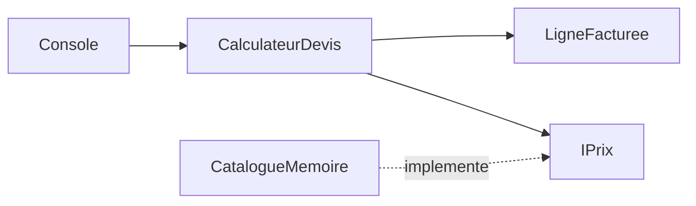

# 15 - Architecture : placer les responsabilites et les dependances

[Precedent](14_Domaine.md) | [Sommaire](README.md) | [Suite : choisir une architecture](16_DecisionArchitecture.md)

## Situation et objectif

Un devis utilise des regles de calcul et un catalogue. Demain, ce catalogue pourrait venir d'une API
au lieu d'un dictionnaire. Le calcul doit-il connaitre HTTP ?
Prerequis : modele metier, Strategy et Adapter. Architecture signifie ici organiser ce qui depend de quoi.

## Exemple guide autonome

```csharp
IPrix catalogue = new CatalogueMemoire();
var service = new CalculateurDevis(catalogue);
Resultat resultat = service.Calculer("A", 2);
Console.WriteLine(resultat switch
{
    Resultat.Accepte accepte => FormattableString.Invariant($"net={accepte.Total:0.00}"),
    Resultat.Refuse refuse => refuse.Motif,
    _ => throw new InvalidOperationException(),
});

public interface IPrix
{
    decimal? Lire(string reference);
}

public sealed class CatalogueMemoire : IPrix
{
    public decimal? Lire(string reference) => reference == "A" ? 12.50m : null;
}

public sealed class LigneFacturee
{
    public decimal Total { get; }
    public LigneFacturee(int quantite, decimal prix)
    {
        ArgumentOutOfRangeException.ThrowIfNegativeOrZero(quantite);
        ArgumentOutOfRangeException.ThrowIfNegative(prix);
        Total = quantite * prix;
    }
}

public abstract record Resultat
{
    public sealed record Accepte(decimal Total) : Resultat;
    public sealed record Refuse(string Motif) : Resultat;
}

public sealed class CalculateurDevis(IPrix catalogue)
{
    public Resultat Calculer(string reference, int quantite)
    {
        if (string.IsNullOrWhiteSpace(reference) || quantite <= 0)
            return new Resultat.Refuse("ligne-invalide");
        decimal? prix = catalogue.Lire(reference);
        if (prix is null) return new Resultat.Refuse("article-inconnu");
        if (prix < 0) throw new InvalidOperationException("Contrat du catalogue viole");
        var ligne = new LigneFacturee(quantite, prix.Value);
        return new Resultat.Accepte(ligne.Total);
    }
}
```

Sortie : `net=25.00`. C'est une version reduite a une ligne, sans remise ; le TP reprend la commande complete.

## Lire le programme par responsabilite

| Element | Role | Ce qu'il ne doit pas faire ici |
|---|---|---|
| LigneFacturee | Calcul et invariants du domaine | Appeler HTTP ou afficher un message |
| CalculateurDevis | Orchestration du cas d'usage | Creer un client fournisseur concret |
| IPrix | Port exige par l'application | Reproduire obligatoirement les tables SQL |
| CatalogueMemoire | Adaptateur de ce port | Porter les regles de commande |
| Debut du programme | Composition et affichage | Refaire les calculs metier |

Le cas d'usage depend du port, l'adaptateur implemente ce port, et la composition choisit les objets.
L'interface exprime le besoin de l'application. Elle ne doit pas devenir une interface « universelle »
avec toutes les methodes de chaque fournisseur.



Le sens des dependances de code n'est pas toujours celui des appels a l'execution.
L'application appelle un adaptateur concret, mais n'a pas besoin de connaitre son type concret.
Cette organisation illustre ports/adaptateurs ; elle ne demande pas automatiquement dix projets.

## A vous : changer le detail sans changer la decision

Remplacer CatalogueMemoire par un autre objet IPrix retournant 20 euros pour A.
Ne pas toucher au cas d'usage. Quel resultat attendre ?
Faire ensuite lever IOException par Lire. Faut-il la transformer en article-inconnu ?

<details>
<summary>Correction raisonnee</summary>

Une implementation IPrix retournant 20 pour A produit `net=40.00` avec la meme application.
Seul le code d'assemblage change.
Une IOException n'est pas un refus metier : la lecture n'a pas abouti, elle ne prouve pas l'absence.
Elle doit remonter a une frontiere technique avec une politique d'erreur explicite.
Les variantes Resultat.Accepte et Refuse permettent de representer les issues metier attendues
sans une combinaison ambiguigue de total optionnel et message optionnel.

</details>

## Tester les frontieres

Tester le domaine sans infrastructure. Tester l'orchestration avec des doubles du port.
Partager des tests de contrat entre adaptateurs pour les comportements communs.
Ajouter des tests d'integration pour SQL ou HTTP reels : un dictionnaire ne reproduit pas leurs pannes,
transactions, collations ou limites reseau.

Le bootcamp reste un seul assembly : cette separation est pedagogique, non imposee par le compilateur.
Des projets separes peuvent imposer certaines dependances dans un produit, si ce cout est justifie.

## Verification et TP

- Un dossier Domaine empeche-t-il automatiquement les appels SQL ? Non.
- Le cas d'usage doit-il choisir un adaptateur ? Non, c'est la composition.
- Ports/adaptateurs impose-t-il des microservices ? Non, cela concerne les dependances, pas le deploiement.

Implementer [Lecon16_Architecture.cs](../Lecons/Lecon16_Architecture.cs), puis `dotnet run -- 16`.
Le TP reutilise les types des lecons 13 a 15 : terminer ces dependances avant d'attendre tous ses tests verts.